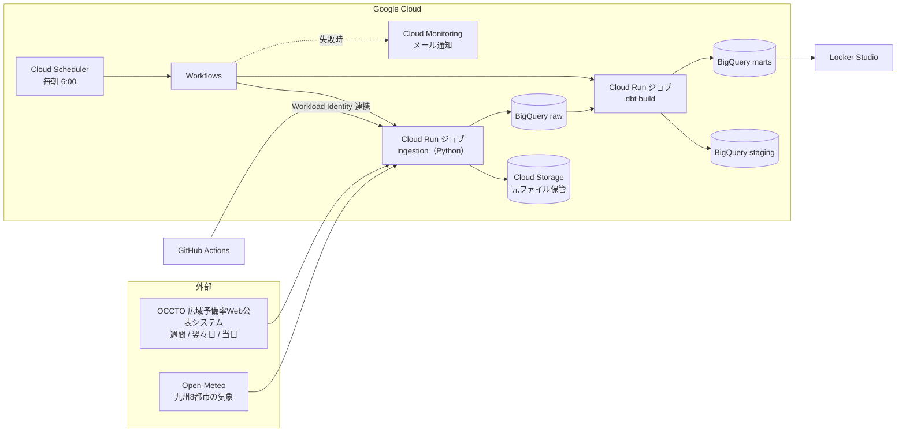

# 九州の電力 予実パイプライン

電力広域的運営推進機関（OCCTO）が公表している **電力需要の予測と当日の最終値** を毎朝自動で取り込み、
気象データと組み合わせて **予測がどれだけ当たったか（予実）** を BigQuery 上で分析できるようにするデータ基盤です。

経営管理の現場で予実管理（予算と実績の差の分析）を担当してきた経験を、
「電力需要の予測 vs 最終値」という公開データで再現し、取り込みから可視化までを Google Cloud 上に構築しました。
全国10エリアを取り込み、九州エリアは気象データとも組み合わせています。

## 全体像



| 層 | 使った技術 | 役割 |
|---|---|---|
| 取り込み | Python, Cloud Run Jobs | CSV の取得・解析・検証、BigQuery への冪等ロード |
| 保管 | Cloud Storage, BigQuery | 元ファイルの保管、日付パーティションの生データ |
| 変換 | dbt（BigQuery） | 型変換・重複除去、予実ファクト、精度の集計、テスト |
| 実行管理 | Cloud Scheduler, Workflows | 取り込み → dbt の順に毎朝実行、失敗したら後続を止める |
| 監視 | Cloud Monitoring | ワークフロー失敗をメール通知、dbt source freshness |
| インフラ | Terraform | 上記すべてをコードで管理 |
| CI/CD | GitHub Actions | lint・テスト・dbt build を PR ごとに実行、main でデプロイ |

## 「予実」の作り方

OCCTO の CSV は、過去の日付を指定すると **その予測を出した時点の値** が返ってきます。これを使って、同じ30分コマについて3つの時点の値を並べています。

| 種類 | いつ時点の値か | 粒度 |
|---|---|---|
| 週間 | 対象日の数日前 | 1日の最大需要・最小予備率の時点のみ |
| 翌々日 | 対象日の2日前 | 30分ごと |
| 翌日・当日 | 対象日の夜（最終公表値） | 30分ごと |

**予測 = 翌々日、最終値 = 当日の最終公表値** として誤差（MAPE・バイアス・ピーク誤差）を計算しています。
最終公表値は確定実績ではなく「当日夜時点で公表されていた最新値」である点に注意してください。

すべての行に **公表時刻（published_at）** を持たせているので、「いつ時点で何が分かっていたか」をたどれます。
dbt のテストで「予測が対象日より前に公表されているか」を確認し、未来の情報が混ざらないようにしています。

## データ品質と再現性で工夫したこと

| 実データで起きること | 対処 |
|---|---|
| 種類（週間・翌々日・当日）ごとに CSV の列の並びが違う | 列を位置ではなく **列名** で特定。必要な列が無ければ `SchemaChangedError` で**取り込まずに止める** |
| 公式に「CSV の仕様は予告なく変更することがある」と明記 | 列名・文字コード・エリア名・公表時刻の行を毎回検証し、想定外なら止める（黙って壊れたデータを入れない） |
| 複数日をまとめて取得すると、公表時刻が先頭の1つしか残らない | **1日ずつ** 取得して、日ごとの公表時刻を保持 |
| 時刻が「コマの終了時刻」（00:30 〜 24:00） | 30分引いて **開始時刻** に変換（24:00 も扱える） |
| 保存期間外の日付を指定すると CSV ではなくエラー画面（HTML）が返る | Content-Type を確認して `DataNotAvailableError` として扱う |
| 公表値は過去にさかのぼって修正されることがある（修正前の値は提供元から提供されない） | 毎朝直近3日分を取り直し、dbt の増分モデルも直近7日分を毎回作り直す。元 CSV のバケットは**世代管理（バージョニング）**を有効にしているので、上書きされても修正前の版が残り、いつ何が修正されたかを後から追える |
| 同じ日を何度流しても結果が同じであってほしい | BigQuery の日付パーティションを丸ごと置き換える（`WRITE_TRUNCATE` + パーティション指定）ので重複しない |
| 後から「どのファイルから来たデータか」を確認したい | 元 CSV を GCS にそのまま保存し、各行に `file_sha256`・`published_at`・`ingested_at` を付与 |
| 週間予測の一部が対象日当日以降に公表されている（2025-04-01 は当日、2025-05-10〜12 は 05-13 公表の版のみ） | 本番データでのテストで検出。対象日より前に公表されたものだけを予測とみなし、それ以外は集計から除外（件数は警告として毎回出す） |
| エリア単体の予備率は、エリア間の融通で極端な値になる（四国 130% など） | 業務上の意味を確認し、公式指標の広域予備率を主に使う。エリア単体は警告のみ |

dbt のテストは、一意性・NULL・値の範囲・参照整合性のほか、次のような独自テストを入れています。

- 予測が対象日より前に公表されているか（データリークの検知）
- 一昨日以前の日は、種類×エリアごとに48コマそろっているか（取り込み漏れの検知）
- 取り込み開始日から抜けている日がないか

## dbt モデル

```
raw（Python が書き込む）
 ├─ stg_occto__demand_30min    30分値（日本時間、公表時刻・リードタイム付き）
 ├─ stg_occto__weekly          週間の最大需要予測
 └─ stg_weather__hourly        九州8都市の気象
      ├─ int_demand__forecast_vs_final  同じコマの「2日前予測」と「当日最終値」を横並びに
      ├─ int_weather__kyushu_hourly     人口で重み付けした九州全体の気象
      └─ int_calendar__days             平日／土日／祝日／長期休暇（内閣府の祝日CSV）
           └─ fct_area_demand_30min            30分×エリアの予実ファクト（増分・パーティション）
                ├─ mart_forecast_accuracy_daily   エリア×日の予測精度（MAPE・バイアス・ピーク誤差・最小予備率）
                ├─ mart_weekly_peak_accuracy      週間予測の最大需要は当たったか
                └─ mart_temperature_sensitivity   九州: 気温帯×曜日区分×時間帯の需要と誤差
```

## セキュリティ・コストの配慮

- **サービスアカウントキーを発行していない**: GitHub Actions は Workload Identity 連携で認証し、自分のリポジトリ以外からは認証できない条件を付けています
- **最小権限**: 取り込み・dbt・実行管理・デプロイ・ビルドでサービスアカウントを分け、データセット単位で権限を付与（例: dbt は raw を読むだけ）
- **課金の暴発防止**: dbt のプロファイルに `maximum_bytes_billed` を設定、予算アラートを設定
- **コスト**: 無料枠の範囲で動く構成（Cloud Run ジョブは1日数十秒、データ量は数十MB）

## データ利用条件の確認

データ元を選ぶときは、利用規約を確認しています。

- 当初は電力会社のサイトの CSV を使う予定でしたが、サイト利用規約で「プログラムによる機械的な取得は事前許可が必要」とされていたため、取得を中止してデータを削除し、データ元を変更しました
- OCCTO の公表データは「出典を記載すれば自由に利用でき、加工した場合はその旨を記載する」という利用条件です
- 取得は1日1回（過去分の一括取得時も含め、リクエスト間隔2秒）にしています

## ローカルで動かす

```bash
python -m venv .venv && .venv/Scripts/activate   # Windows
pip install -r requirements-dev.txt

pytest -q                                   # パーサーのテスト
python -m ingestion.main --sink local --start 2026-11-20 --end 2026-11-21   # data/ に保存

# BigQuery に対して dbt を実行（gcloud auth application-default login 済みであること）
export GCP_PROJECT=<your-project> PYTHONUTF8=1
dbt deps  --project-dir dbt --profiles-dir dbt
dbt build --project-dir dbt --profiles-dir dbt           # dev_local データセットに作成
```

## インフラの構築

```bash
cd terraform
cp terraform.tfvars.example terraform.tfvars    # 値を書き換える
gcloud storage buckets create gs://<project>-tfstate --location asia-northeast1
terraform init -backend-config="bucket=<project>-tfstate"
terraform apply
```

## 出典

- 電力広域的運営推進機関「広域予備率Web公表システム」 https://web-kohyo.occto.or.jp/kks-web-public/
  （本リポジトリのデータ・集計結果は、同データを加工して作成したものです）
- 気象データ: [Open-Meteo](https://open-meteo.com/)（CC BY 4.0）
- 祝日: 内閣府「国民の祝日について」
